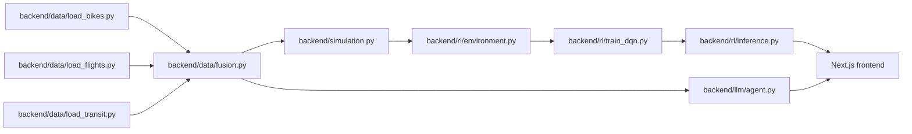
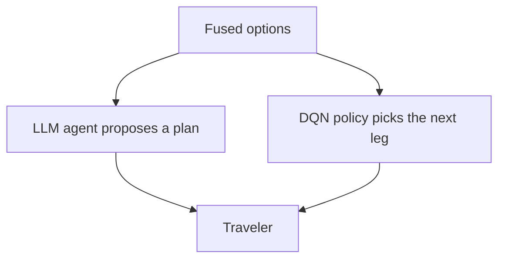

# Route optimizer

A multi-stop trip planner that can pull bikes, flights, and transit into one itinerary, ask a language-model agent to reason about the trip, and train a DQN policy for the sequential choice of what to do next.

The frontend is a Next.js app. The backend is FastAPI-style Python (`backend/main.py`) with three ideas side by side: data fusion, an LLM agent, and reinforcement learning.


## How a trip is built



| Path | What it is |
|---|---|
| `backend/data/load_bikes.py` | Bike-share options |
| `backend/data/load_flights.py` | Flight options |
| `backend/data/load_transit.py` | Transit options |
| `backend/data/fusion.py` | One picture of the trip |
| `backend/simulation.py` | The world the policy trains in |
| `backend/rl/environment.py` | State, action, reward |
| `backend/rl/train_dqn.py` | Train the DQN |
| `backend/rl/inference.py` | Use a trained policy |
| `backend/llm/agent.py` | Language-model agent over the trip |
| `backend/llm/prompts.py` | The instructions that agent sees |
| `frontend/src/app/page.tsx` | The planner |
| `frontend/src/app/chat/page.tsx` | The chat surface |
| `frontend/public/map-preview.png` | Map preview used by the UI |

## Two ways the app chooses



The agent is for a plan you can read. The DQN is for a sequential decision under the simulation in `backend/rl/environment.py`. They are different tools for the same product surface, and the repo keeps them in separate packages so that stays obvious.

## Run it

Backend:

```bash
cd backend
python -m venv .venv && source .venv/bin/activate
pip install -r requirements.txt
python main.py
```

Frontend:

```bash
cd frontend
npm install
npm run dev
```

## What this signals

A product that mixes optimization, a language model, and a learned policy, with a real UI in front of it. The map and the chat are the interface; the fusion layer is the system.
