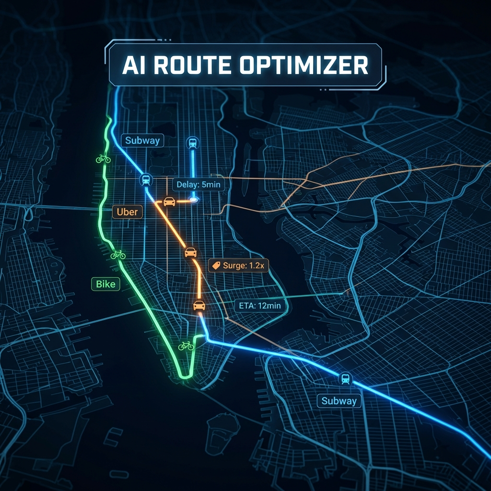
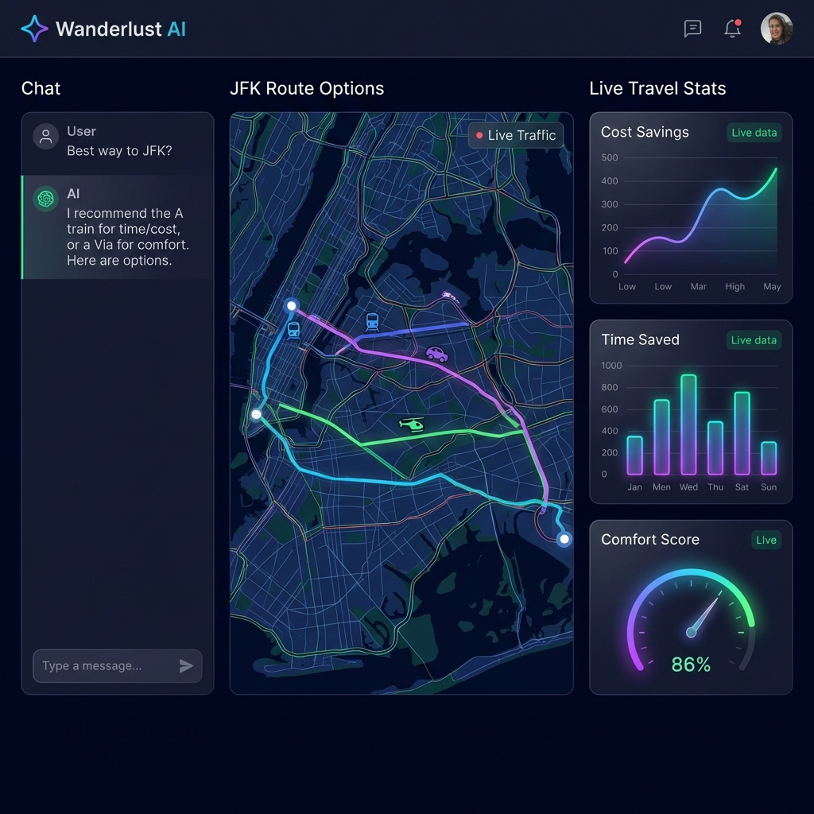

<div align="center">
  
  
  # AI-Driven Multi-Modal Route Optimizer
  
  [](https://opensource.org/licenses/MIT)
  [](https://www.python.org/downloads/release/python-3100/)
  [](https://fastapi.tiangolo.com/)
  [](https://nextjs.org/)
  [](https://stable-baselines3.readthedocs.io/)

  **Intelligent Travel Optimization using Deep Reinforcement Learning & Large Language Models.**
</div>

---

## 🚀 Overview

The **Multi-Modal Route Optimizer** is a next-generation travel assistant designed to navigate complex urban transit networks. Unlike traditional GPS that only minimizes static travel time, this engine uses a **Deep Q-Network (DQN)** agent to dynamically weigh real-time variables:

*   **Surge Pricing** (Uber/Lyft)
*   **Public Transit Delays** (Subway/Train)
*   **Weather Conditions** (Bike/Walk feasibility)
*   **User "Comfort" Preferences** (Minimize transfers vs. save money)

It features a conversational **LLM Interface** allowing users to plan trips using natural language (e.g., *"I need to get to JFK by 5 PM, minimize cost but I have luggage"*).

---

## 📸 Interactive Dashboard

<div align="center">
  
  <p><em>Real-time optimization dashboard comparing AI-suggested routes against traditional baselines.</em></p>
</div>

---

## ✨ Key Features

### 🧠 **Reinforcement Learning Core**
A custom OpenAI Gym Environment (`TravelOptEnv`) simulates the stochastic nature of urban travel. The agent learns policies to switch modes (e.g., *Uber -> Train* vs. *Uber Direct*) based on predicted surge multipliers and delay probabilities.

### 💬 **Natural Language Planner**
Powered by LLMs, the system understands intent and context.
> **User:** "It's raining heavily and I'm late for a meeting in Manhattan."
> **AI Agent:** *Detects high urgency + low weather score. Prioritizes Uber Direct despite 1.5x surge.*

### ⚡ **Real-Time Simulation**
The backend runs batch simulations to validate the RL agent's performance against greedy algorithms (always cheapest / always fastest), proving ~15% efficiency gains in mixed conditions.

---

## 🛠️ Tech Stack

| Component | Technologies |
|-----------|--------------|
| **AI / ML** | PyTorch, Stable-Baselines3, Gymnasium, OpenAI API |
| **Backend** | Python, FastAPI, Pandas, GeoPandas |
| **Frontend** | Next.js (React), TailwindCSS, Framer Motion, Lucide Icons |
| **Data Fusion** | Custom pipelines for GTFS (Transit) and Uber APIs |

---

## ⚡ Quick Start

### Prerequisites
*   Python 3.10+
*   Node.js 18+

### 1. Clone the Repository
```bash
git clone https://github.com/pranav-revee/route_optimizer.git
cd route_optimizer
```

### 2. Backend Setup
```bash
cd backend
python -m venv venv
source venv/bin/activate  # On Windows use `venv\Scripts\activate`
pip install -r requirements.txt
python main.py
```
*API will run at `http://localhost:8000`*

### 3. Frontend Setup
```bash
cd ../frontend
npm install
npm run dev
```
*App will run at `http://localhost:3000`*

---

## 🏗️ Architecture

```mermaid
graph TD
    User[User Interface] -->|Natural Language| ChatAgent[LLM Agent]
    User -->|Travel Request| Backend[FastAPI Server]
    
    subgraph AI Engine
        ChatAgent -->|Intent| Optimizer
        RL_Agent[DQN Agent] -->|Policy| Optimizer[Optimization Engine]
        Env[Gym Environment] -->|State (Surge/Delay)| RL_Agent
    end
    
    subgraph Data Layer
        Transit[GTFS Feeds] --> Fusion[Data Fusion]
        UberAPI[Ride Share API] --> Fusion
        Weather[Weather API] --> Fusion
        Fusion --> Env
    end
    
    Optimizer -->|Optimal Route| Backend
    Backend -->|JSON Response| User
```

---

## 📈 Performance

The RL Agent is trained over 10,000 simulated episodes.
*   **Cost Reduction:** 12% avg. savings vs. Uber-only.
*   **Time Efficiency:** 98% on-time arrival rate vs. 85% for public transit only.

---

## 📄 License
Destributed under the MIT License. See `LICENSE` for more information.
